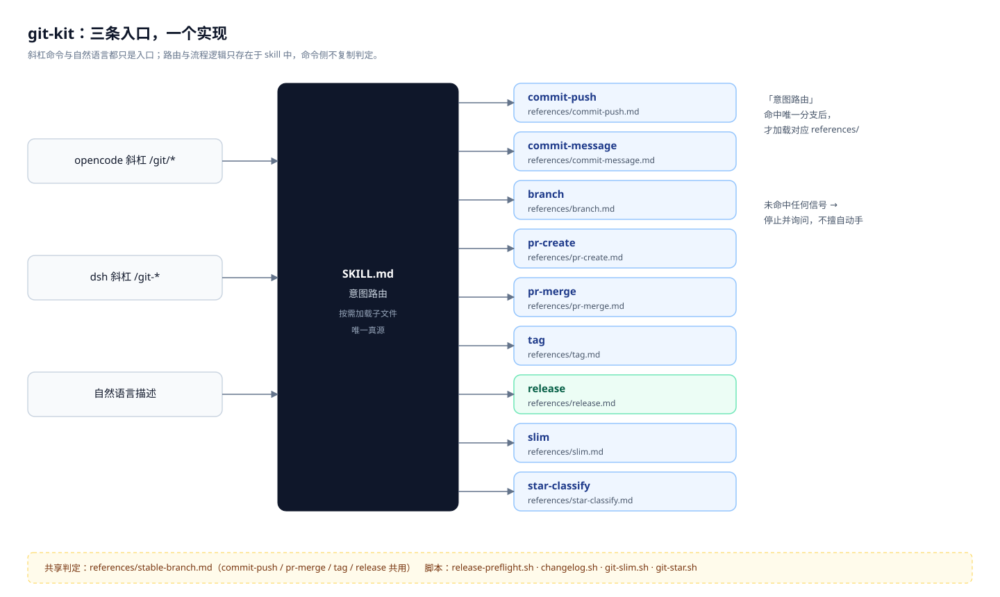
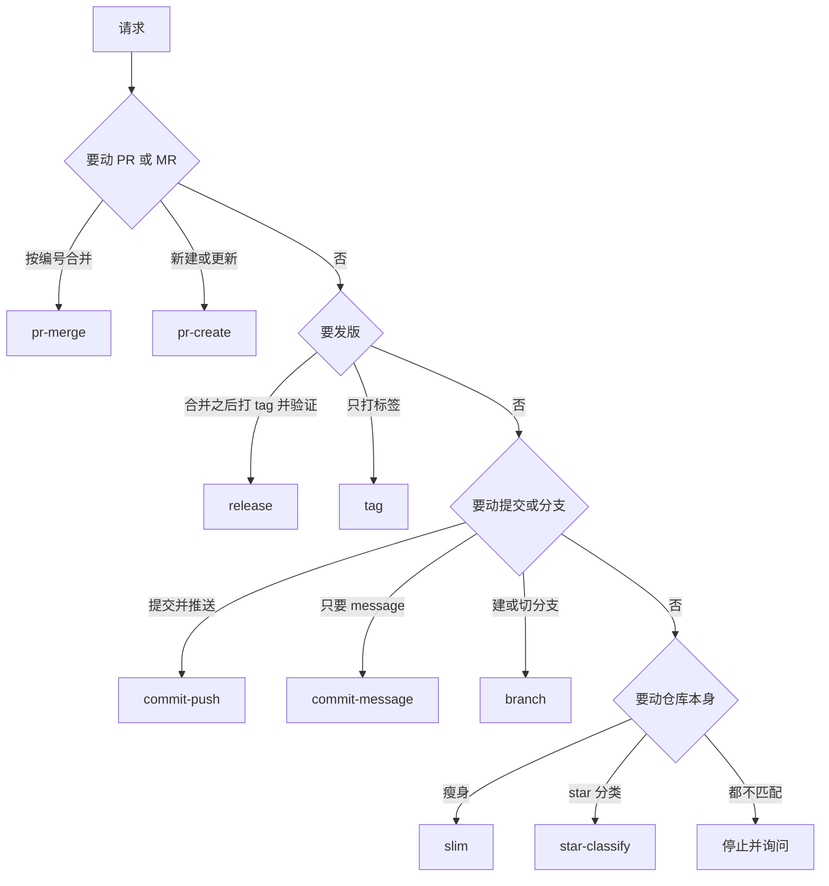
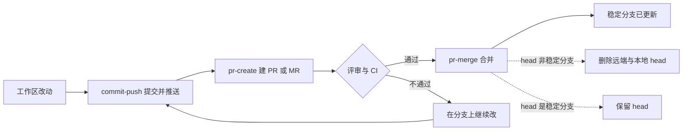
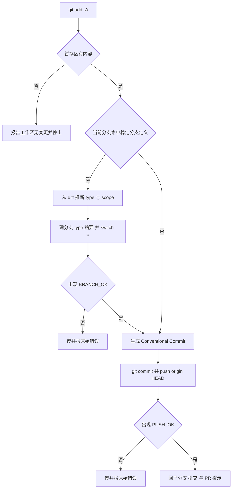
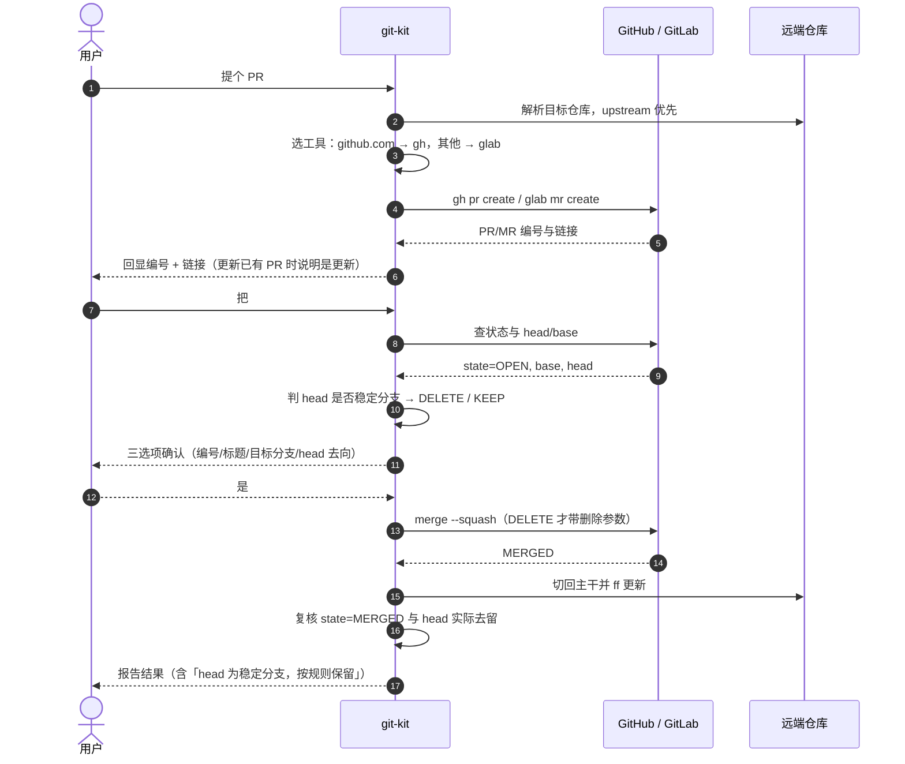
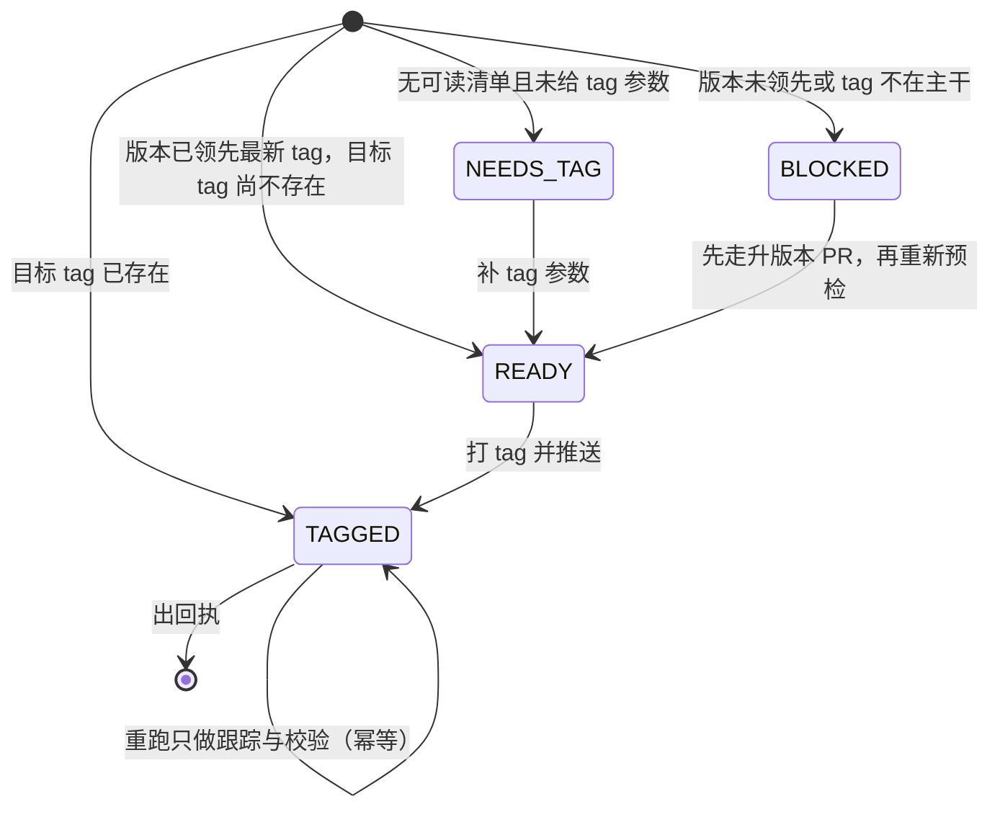
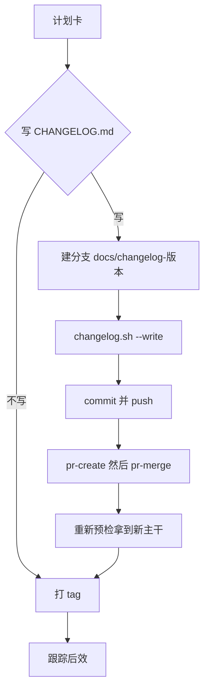
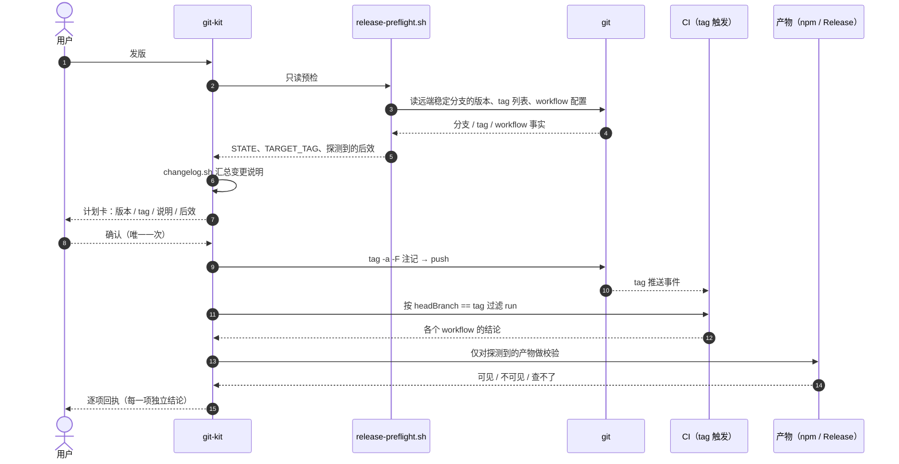

# git-kit 工作流

> 一份说明文档，覆盖 git-kit 的入口与路由、从改动到主干的链路、以及 `pr-merge` 之后的发版段。
>
> 与 [`skills/git-kit/SKILL.md`](../skills/git-kit/SKILL.md) 的分工：**SKILL.md 是给模型看的操作指令**（意图路由 + 按需加载），**本文是给人看的解释**——为什么这样切分、每条链路的边界在哪、失败时怎么处置。两者不互相替代。



## 三条入口，一个实现

opencode 斜杠命令（`commands-opencode/git/*.md`）和 dsh 斜杠命令（`commands-dsh/lib/index.js`）都只是**委托壳**：它们声明「命令 → skill 分支」的映射，不写任何判定。所以同一句「把 PR 合并掉」，无论从斜杠命令来还是直接说出来，走的都是同一份逻辑。

改行为时记住这条：**改逻辑改 skill，改入口只加入口**。在命令侧复制一份判定，就是两份真源。

## 意图路由：先判对象，再判阶段

路由的实质是一次决策：先看要动的是**什么对象**（PR / tag / 提交 / 分支 / 仓库 / star），再看**处在哪个阶段**（准备、提交、评审、合并、发布）。



三个路由细节值得单独说：

| 情形 | 处理 |
|---|---|
| `tag` 与 `release` 都含「tag」 | 看是否在**合并之后**、是否要盯发布结果：只要一个标签 → `tag`；要打 tag 并跟踪后效 → `release` |
| 一个请求同时含多步 | 按链路顺序连续执行（如「改了代码，提交并提个 PR」→ `commit-push` → `pr-create`），不拆成多次询问 |
| 信号不足 | **不猜**：停下来问。合并、删除、打 tag 都难回收，宁可多一轮 |

## 九个分支速查

| 分支 | 做什么 | 典型说法 | 逻辑在 |
|---|---|---|---|
| `commit-message` | 只看 diff 生成 message，不提交 | 「写个 commit 信息」 | `references/commit-message.md` |
| `commit-push` | 分析变更 → 提交 → 推送（稳定分支上先自动建分支） | 「提交一下」「推上去」 | `references/commit-push.md` |
| `branch` | 中文描述 → 3 个候选分支名 → 建并切 | 「开个分支做登录」 | `references/branch.md` |
| `pr-create` | 建或更新 PR/MR，自动识别 gh/glab | 「提个 PR」 | `references/pr-create.md` |
| `pr-merge` | 按编号合并 → 切回主干 → 更新代码 → 处理 head 去留 | 「把 #12 合了」 | `references/pr-merge.md` |
| `tag` | 打 annotated tag 并推送（含注记正文） | 「打个 tag」 | `references/tag.md` |
| `release` | `pr-merge` 之后的发布段：打 tag → 跟踪后效 → 回执 | 「发版」 | `references/release.md` |
| `slim` | 当前仓库瘦身为浅克隆 | 「把仓库瘦身」 | `references/slim.md` |
| `star-classify` | 拉取并分类 GitHub star | 「分类我的 star」 | `references/star-classify.md` |

## 共同基石：稳定分支的唯一定义

「稳定分支」在 git-kit 里**只有一处定义**（`references/stable-branch.md`），四个分支各自决定「命中后怎么办」，不复述判定表。这是最容易被改坏的地方：一旦某个分支自己写一套正则，`release/*` 这类分支的待遇就会开始漂移。

对分支名**全名**匹配，命中任一即稳定分支：

| 类别 | 命中形式 |
|---|---|
| 主干 / 集成 | `main`、`master`、`trunk`、`develop`、`development`、`dev`、`integration` 等 |
| 目标仓库默认分支 | 远端 `HEAD branch` 指向的分支（名字不在上表也算） |
| 发布 | `release`、`release/*`、`release-*`、`releases/*` |
| 稳定 / 维护 | `stable*`、`maintenance/*`、`maint/*`、`support/*`、`lts/*` |
| 版本线 | `1.x`、`2.0.x`、`v3.x` 这类整名匹配 |

**没有"名字里带 release 就算"** —— `feature/release-notes`、`fix/release-lock` 都不是稳定分支。

命中之后，各分支的动作才是差异点：

| 分支 | 命中稳定分支时 |
|---|---|
| `commit-push` | **不直接提交**：先建工作分支再提交（改版本号也不豁免） |
| `pr-merge` | head 是稳定分支 → `KEEP`，**一律保留不删** |
| `tag` | **优先**作为 tag 来源（偏好，非禁止） |
| `release` | 以远端稳定分支为发布基准，读它的版本号 |

## 从改动到主干

这条链路把工作区里的改动送到稳定分支：`commit-push` → `pr-create` → `pr-merge`。三个分支各管一段，衔接处靠 git 与平台（GitHub/GitLab）的状态说话。



`commit-push` 结束时给出 PR 提示（分支名、目标分支、可比对的提交），`pr-create` 用它建 PR；`pr-merge` 结束后切回主干并 `pull --ff-only`，让本地立刻处在可继续开发的状态。

### commit-push：在稳定分支上自动分叉

这是整套流程里最容易踩坑的一步。规则很硬：**稳定分支不接受直接提交**，包括「改版本号准备发版」这种看起来理所当然的例外。



三个细节：

- **先 `git add -A` 再分析**：没有暂存区就看不出改了什么，也就推断不出分支名与 message。
- **无变更时既不建分支也不提交**：空提交比"看起来执行了"更糟，直接如实报告。
- **`BRANCH_OK` / `PUSH_OK` 是硬门槛**：没看到就当作失败，不许声称完成。

### 分支命名

`branch` 分支负责「中文描述 → 候选分支名」，`commit-push` 在稳定分支上自动分叉时复用同一套映射：

| 中文语义 | 前缀 | 例子 |
|---|---|---|
| 新增、添加、实现 | `feature/` | `feature/user-auth` |
| 修复、解决 | `fix/` | `fix/login-password-validation` |
| 重构 | `refactor/` | `refactor/order-module` |
| 文档 / 格式 / 测试 / 构建 / 性能 | `docs/` `style/` `test/` `chore/` `perf/` | `perf/homepage-load-speed` |
| 热修复生产问题 | `hotfix/` | `hotfix/login-crash` |
| 发布准备 | `release/` | `release/v2.0` |
| 实验 / 概念验证 | `experiment/` `poc/` | `poc/new-parser` |

命名统一 kebab-case 小写、≤50 字符、概括意图；`branch` 一次给 3 个风格不同的候选让用户选，`commit-push` 自动分叉时则直接按 diff 归纳一个。

### PR 生命周期时序



`pr-merge` 默认 squash 合并；用户要 merge/rebase 时只换合并参数，**删除参数的取舍不变**。

### head 去留：为什么 `release/*` 不能删

删除参数是**服务端删除**（gh `--delete-branch` 连远端带本地，glab `--remove-source-branch` 删远端），下发后无法事后补救。所以判定放在**合并前**，得出 `DELETE` 或 `KEEP` 再决定命令带不带参数。

| head 类型 | 判定 | 理由 |
|---|---|---|
| `feature/*`、`fix/*`、`chore/*` 等短生命周期分支 | `DELETE` | 内容已进主干，留着只是噪音 |
| `main` / `master` / `trunk` / `develop` 等主干与集成分支 | `KEEP` | 是长期分支，删了等于删仓库骨架 |
| `release/*`、`stable/*`、`maintenance/*`、`support/*`、`lts/*` | `KEEP` | 发布/维护线还要继续用，常受保护也删不掉 |
| `1.x`、`v3.x` 这类版本线 | `KEEP` | 同上 |
| 远端默认分支 | `KEEP` | 平台本就禁止删除 |

**硬规则**：`KEEP` 时全程不传删除参数、不清理本地同名分支。即使用户显式要求删这个 head，也改为说明「该 head 是稳定分支，按规则保留」，不静默执行也不假装删了。

### 失败与回退

| 现象 | 正确处理 |
|---|---|
| `nothing to commit` / 暂存区为空 | 如实报告「工作区无变更」，不建分支、不提交 |
| `git push` 被拒（远端有新提交） | 停并展示原始报错；是否 rebase/merge 由用户定，不擅自 force push |
| `gh pr create` 报「已存在 PR」 | 转为更新该 PR，说明是更新而非新建 |
| PR 状态已 `MERGED`/`CLOSED` | 停止，不重复合并 |
| 合并时冲突 / CI 未过 / 权限不足 | 停在当前状态，完整贴出平台原始报错，不伪造成功 |
| `DELETE` 但平台拒绝删除 | 如实报告「未删除」+ 原始报错；不重试、不改判定 |

## 发版：tag 与 release

发版段只覆盖 `pr-merge` **之后**的事：版本号已经在稳定分支上了，剩下的工作是打 tag、盯住 tag 触发的后效、给出回执。

### 两个词的边界

| | `tag` | `release` |
|---|---|---|
| 起点 | 任意分支、任意时机 | 稳定分支（`pr-merge` 之后） |
| 做什么 | 打 annotated tag 并推送 | 打 tag → 跟踪 tag 触发的后效 → 逐项校验 → 回执 |
| 版本来源 | 用户指定或从分支名推断 | 从稳定分支的 `package.json` 读，或以 tag 为源 |
| 结束标志 | `TAG_PUSH_OK` | `STATE` + 每项后效的独立结论 |
| 不做 | 发布、验证 | 改版本号、建无关分支、开无关 PR、回合并（写 `CHANGELOG.md` 的唯一例外见下） |

一句话：**`tag` 是动作，`release` 是流程**。只想打个标签用 `tag`；想打完还知道"发出去没有"用 `release`。

### 状态机

预检把仓库事实压成一个 `STATE`，流程由它驱动，而不是由人记得做到哪一步：



| STATE | 含义 | 下一步 |
|---|---|---|
| `READY` | 版本已领先、目标 tag 不存在 | 确认计划卡 → 打 tag |
| `TAGGED` | tag 已在（可能刚打完，也可能之前打过） | 跳过打 tag，只跟踪与校验 |
| `NEEDS_TAG` | 没有可读的版本清单，也没给 `--tag` | 向用户索取目标 tag |
| `BLOCKED` | 有阻断项 | 按 `BLOCKERS` 逐条处理，通常先走升版本 PR |

### 可选的 CHANGELOG.md：唯一一次越界

`release` 默认不碰工作区。唯一例外是**用户在选择时明确要写 `CHANGELOG.md`**：这时会为这一个文件开一次分支 + PR。原因是文件必须走评审，而 tag 一旦打出去就不能改——所以记录必须**先进主干，再打 tag**。



三条约束：

- **顺序不可颠倒**：CHANGELOG PR 没合进稳定分支之前不打 tag，否则 tag 指向的那次提交里没有这条记录。
- **只改一个文件**：除了 `CHANGELOG.md` 不动任何文件，也不改版本号。
- **幂等**：`changelog.sh --write` 发现该版本小节已存在就以退出码 `3` 结束（视为完成）；无可记录变更则退出码 `4`（跳过写文件，直接去打 tag）。

### 发布时序



关键点：**确认只有一次**，但计划卡里必须包含 tag 注记的完整正文——tag 推送后正文不可改，这是唯一能反悔的时机。正文在确认时**落盘冻结**，后面即使主干因 CHANGELOG PR 前移，打 tag 也复用这份文件，不重算。

### 预检：把仓库事实查清楚

预检**只读**：不写文件、不切分支、不打 tag。

```bash
# 在仓库根执行（脚本自行定位 git 顶层）
bash skills/git-kit/scripts/release-preflight.sh
bash skills/git-kit/scripts/release-preflight.sh --tag v1.1.0   # 无可读版本清单时
```

选项有 `--remote`、`--pkg`、`--tag`、`--no-fetch`、`--no-npm`；退出码 `0` 可继续 / `2` 有阻断项 / `1` 参数或环境错误。

| 输出 | 含义 |
|---|---|
| `VERSION_SOURCE` | `manifest`（读 `package.json`）或 `tag`（以 tag 为版本源） |
| `PKG_VERSION` / `TARGET_TAG` | 当前版本、将要打的 tag |
| `PKG_CANDIDATES` | 多包仓库里可选的发布包（配 `--pkg` 指定） |
| `TAG_EXISTS` / `TAG_ON_BASE` | tag 是否已存在、是否在稳定分支历史上 |
| `LATEST_SEMVER` | 最新 tag 能否参与版本比较（`v` 前缀不是判据） |
| `TAG_WORKFLOWS` | `on: tags:` 的 workflow 列表（空 = 未检测到） |
| `EFFECT_NPM` / `EFFECT_GH_RELEASE` | 是否探测到对应后效 |
| `NPM_PUBLISHED` | `yes` / `no` / `unknown` / `skipped` |
| `COMMITS` / `TOTAL_COMMITS` | 变更说明收录数 / 区间总提交数 |
| `STATE` / `WARN` / `BLOCKERS` | 流程状态、非阻断提醒、阻断项 |

阻断项与提醒性质不同，处置也不同。**阻断项都会让流程停下**：除「无版本源」是 `NEEDS_TAG` 外，其余一律把 `STATE` 置为 `BLOCKED`（`STATE` 才是流程驱动量）：

| 类型 | 值 | 处置 |
|---|---|---|
| 阻断 | `no-version-source` | 索取 `--tag` 或先补版本清单 |
| 阻断 | `version-not-ahead-of-tag` | 先走升版本 PR，**不在 release 里改版本号** |
| 阻断 | `tag-not-on-base` | tag 打错分支，删除重打需用户显式授权 |
| 阻断 | `tag-version-mismatch` | `--tag` 与清单版本不一致：改 tag 或先升版本 |
| 提醒 | `npm-unknown` | 查不了（网络/缓存），不是"未发布" |
| 提醒 | `gh-missing` | 无法跟踪流水，需人工确认 |
| 提醒 | `dirty-worktree` | 不阻断：打 tag 不碰工作区 |
| 提醒 | `latest-tag-not-semver` | tag 无法与版本比较（守卫跳过），需人工确认 |
| 提醒 | `multiple-publish-packages` | 按 `PKG_CANDIDATES` 用 `--pkg` 指定发布包 |
| 提醒 | `commits-truncated` | 变更说明超 300 条，需要时给 `changelog.sh` 加 `--max` |

### 后效：探测，不假设

"发版"在不同仓库意味着不同的事。git-kit 只保证**tag 已推送、指向稳定分支、版本一致**；之后发生什么一律按仓库事实探测：

| 信号 | 探测依据 | 校验 |
|---|---|---|
| 发布流水 | workflow 的 `on:` 段含 `tags:` | 每个 workflow 的 run 结论（按 `headBranch == tag` 匹配） |
| npm | `package.json` 有 `publishConfig`，或 workflow 含 `npm publish` | `npm view <name>@<version>` |
| GitHub Release | tag workflow 含 `action-gh-release` / `gh release create` | `gh release view <tag>` + notes 非空 |
| 镜像 / 文档站 / 部署 | **不探测** | 标「未检测到」，由人确认 |

三种仓库跑同一套流程的结果：

| 仓库形态 | `TAG_WORKFLOWS` | `EFFECT_NPM` | 回执里出现的行 |
|---|---|---|---|
| npm 包（本仓） | `release.yml` | `yes` | 流水 ✅ + npm ✅ |
| 容器镜像 | `image.yml` | `no` | 只有流水 |
| 无 workflow | 空 | `no` | 明确写「未检测到 tag 触发的发布流水；tag 即交付物」 |

**探测不到 ≠ 没有后效。** 报告写「未检测到可校验的后效」，不写「无后效」，也不把没探到的东西当失败。探测只看**未注释**的行——workflow 头部注释常提到 `tags:` / `npm publish`，注释不算后效。非 GitHub 平台（GitLab/Gitea）不猜流水状态，标「需人工确认」。

### 变更说明：tag 注记的唯一来源

注记正文由 `scripts/changelog.sh` 从 Conventional Commits 汇总，`tag` 与 `release` **共用同一实现**：

```bash
bash skills/git-kit/scripts/changelog.sh --from v0.1.4 --to origin/main --link-to v0.1.5   # 常规
bash skills/git-kit/scripts/changelog.sh --to v0.1.0                                        # 首个版本
```

写进仓库文件（由上面的可选分支调用，`--version` 同时决定小节标题 `## [v1.1.0] - 2026-10-22`）：

```bash
bash skills/git-kit/scripts/changelog.sh --from v0.1.4 --to origin/main \
     --version v0.1.5 --link-to v0.1.5 --write CHANGELOG.md
```

退出码：`0` 已写入 ／ `3` 该版本已记录（跳过）／ `4` 无变更可记录。文件不存在会新建并带 `# Changelog` 抬头；已存在则插入到首个 `## ` 小节之前，旧记录保持原样。

`--link-to` 决定 compare 链接的右端，应指向**即将打的 tag**：`--to origin/main` 是远端跟踪名，直接拼进 GitHub 链接必然 404（脚本会兜底剥掉远端前缀，但指向 tag 才是发布语义）。收录上限默认 300 条，区间更长时向 stderr 告警，不会静默截断。

规则：按 type 分组、固定章节顺序、带 scope 的标 `**scope**:`、`!:` 或正文含 `BREAKING CHANGE` 的只进 Breaking 组（**breaking 判定先于类型过滤**，`chore!:` 不会丢）、过滤 `chore(release)` / `docs(changelog)` 这类版本记录提交、默认不收 `chore/ci/build/test/style`（`--all` 开启）、末尾附 compare 链接。

输出直接成为 tag 正文：

```
release: v0.1.5

### Fixes

- **commands-dsh**: add read fallback for handoff command (#33)

**Full Changelog**: https://github.com/morehao/ai-kit/compare/v0.1.4...v0.1.5
```

```bash
NOTES="$(mktemp)"
{ echo "release: ${TARGET_TAG}"; echo; \
  bash skills/git-kit/scripts/changelog.sh --from "${LATEST_TAG}" --to "${BASE_REF}" --link-to "${TARGET_TAG}"; } > "$NOTES"
git tag -a "${TARGET_TAG}" -F "$NOTES" "${BASE_REF}"
```

因为 tag 不可改，**说明必须在打 tag 前给用户过目**；用户可以改写或精简到只剩首行。正文在计划卡阶段就**落盘冻结**：即使之后（可选）合入了 CHANGELOG PR 让主干前移，打 tag 仍用这份已确认的文件，不重新生成——否则 `docs(changelog)` 提交会混进正文，且与 `CHANGELOG.md` 对不上。

### 失败矩阵

| 情况 | 处理 |
|---|---|
| 版本没领先 tag | `BLOCKED`，先走升版本 PR，release 里不改版本 |
| tag 已存在且正确 | `TAGGED`，跳过打 tag，只跟踪与校验（重跑幂等） |
| workflow 失败 | **不删 tag 重打**：给 run 链接，建议 `gh run rerun <id>` 或进下一个版本号 |
| workflow 仍在跑 | 可中止；重跑从 `TAGGED` 继续跟踪，不会重复打 tag |
| npm / Release 查不了 | 报「未知」，不并入成功也不判失败 |
| tag 打错分支 | `STATE=BLOCKED` + `tag-not-on-base`；删除重打必须用户显式授权 |
| `--tag` 与清单版本不一致 | `STATE=BLOCKED` + `tag-version-mismatch`；改 tag 或先升版本，不静默改目标 |

### 发版段的边界

- **不做**：改 `package.json`、改代码、删/重打 tag、force push、`npm unpublish`（只能 `deprecate`）、改 workflow、代跑发布脚本
- **唯一例外**：用户选择写 `CHANGELOG.md` 时，建**一个** `docs/changelog-<tag>` 分支并走一次 `pr-create` → `pr-merge`；不选则完全不碰工作区
- **不假设**：不内置"发版必须发 npm"这类判断；npm 只是探测到才校验的一项后效
- **不替代**：`tag`（任意分支打标签）、`pr-merge`（合并本身）

## 维护类分支

`slim` 与 `star-classify` 跟提交链路无关，是仓库/账号级的杂务：

- **`slim`**：把历史很重的仓库换成浅克隆，保留远端与分支，只砍历史。适合「clone 太慢」「磁盘吃紧」，不适合要 `git log` 深查的仓库。
- **`star-classify`**：拉取 GitHub star 列表并按主题归类，输出可读的分类结果。

两者都是「一次性动作 + 校验输出」，没有跨分支的约定。

## 改东西时去哪儿

| 你想改 | 改哪儿 |
|---|---|
| 稳定分支判定 | `references/stable-branch.md`（改这里等于改四个分支） |
| 某个流程的步骤/验收 | `references/<分支>.md` |
| 机械动作（预检、变更说明、瘦身） | `scripts/*.sh` |
| 加一个新入口（新命令） | `commands-opencode/git/*.md` 或 `commands-dsh/lib/index.js`，**只加声明** |
| 本文档的图 | `docs/assets/`（SVG）或本文内联的 Mermaid 块 |

## 常见误区

### 提交与合并

1. **"只是改个版本号，直接在 main 上提交"** —— 发版升版本不豁免，同样走分支 → PR → 合并，合并后才打 tag。
2. **"合并完顺手把 release/2.0 删了"** —— 稳定分支 head 一律 `KEEP`；删除是服务端不可逆操作。
3. **`gh repo view origin`** —— 远端名不是仓库标识，会被解析成 `owner/origin` 并报仓库不存在；要先按 `references/repo-id.md` 得到 `[HOST/]OWNER/REPO`。
4. **glab 合并后以为本地分支也没了** —— glab 只删远端，本地残留要按 `DELETE` 规则手动清理；`KEEP` 时则本地也保留。
5. **用「删成功了没」当验收** —— 唯一判据是合并前算出的 `DELETE`/`KEEP`，不是命令是否报错。

### 发版

1. **"release 会顺手把版本号升了"** —— 不会。升版本属于前置 PR，release 只读取它。
2. **"发版一定要发 npm"** —— 那是本仓的后效，不是通用规律；Go / 容器 / 静态站仓库的同一流程不会出现 npm 那一行。
3. **"tag 打错了，改一下"** —— tag 推送后不可编辑，只能删了重打，且需要用户授权；所以注记正文与目标 sha 都要在推送前确认。
4. **"没检测到发布流水就是没发出去"** —— 只说明本仓没有 `tags:` 触发的 workflow，或者发布走的是别的方式（手动、外部流水）；报告只呈现事实。
5. **"npm 查不到就是发布失败"** —— 可能是缓存/网络导致查不了（`NPM_PUBLISHED=unknown`），两者要分开报。

## 参考

- 操作指令（模型侧）：[`skills/git-kit/SKILL.md`](../skills/git-kit/SKILL.md)
- 分支细节：`skills/git-kit/references/`（`stable-branch.md`、`commit-format.md`、`tag.md`、`release.md` 等）
- 脚本：`skills/git-kit/scripts/`（`release-preflight.sh`、`changelog.sh`、`git-slim.sh`、`git-star.sh`）
- 本仓的 npm 发布流程：[`PUBLISHING.md`](../PUBLISHING.md)
