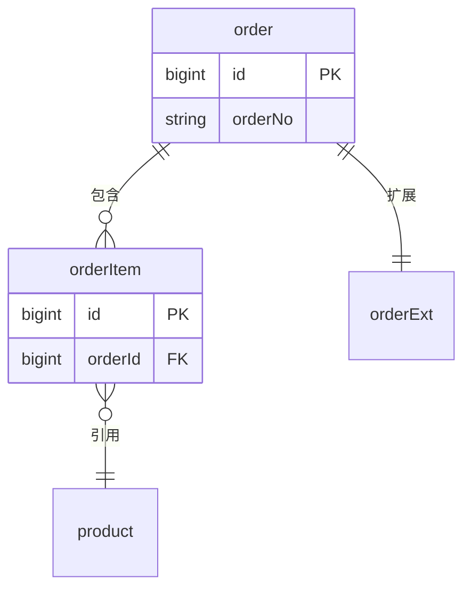

# 数据库设计落法（data-model）

数据库设计**写在文档的哪个位置、以什么形态出现**。凡方案里出现表结构就走本文（专题「数据模型设计」命中时必读；S2 改表、S4 换存储时同样必读）。

一句话：**正文用表格讲设计，一张简版 ER 图讲关系，DDL 收进附录**。

| 层 | 载体 | 回答什么 | 谁在看 |
|----|------|----------|--------|
| 关系 | **简版 ER 图**（一张） | 有哪些实体、谁连着谁、基数多少 | 所有人（先看这张建立全局） |
| 设计 | **正文表格**（实体清单 / 字段 / 索引与查询匹配） | 为什么这么建：字段的业务含义、约束的用意、索引服务哪条查询、数据量与增长 | 评审人、上下游调用方 |
| 实现 | **附录 DDL**（`### 数据模型 DDL`） | 最终可执行的精确形态：类型长度、可空与默认值、字符集、索引语法 | 开发者、DBA、迁移脚本 |

三层**职责不重叠**：图不画全字段，正文不贴 DDL，DDL 不写论证。三者**名字必须对得上**（实体名、字段名、索引名）。

## 简版 ER 图

- **只画三样**：实体（英文语义名 + 中文名）、主键、关系与基数（`||--o{`）。**不画全字段**——字段一铺开，图就退化成一张难读的表，关系反而看不见了。要表达字段/索引是正文表格的事。
- 工具按规模选（`quality-bar.md` 图规范）：

  | 情形 | 工具 |
  |------|------|
  | 实体 ≤ 约 10 个、关系近线性、无交叉 | Mermaid `erDiagram` |
  | 实体 ≥ 12、关系交叉多，或需按模块/按库两侧对齐（分区） | SVG（走 `svg-maker`） |

- 实体名用**英文语义化**（`orderItem`，禁止 `T1`/中文 ID），关系标签用中文并加引号；表名在 DDL 里是 `snake_case` 时，在实体清单表给一次映射，不重复解释。
- 图前有导读段、图后有落着（`quality-bar.md`）；ER 图与**实体清单表逐行对得上**——只画了核心表却漏掉关联表/明细表是最常见的错，两头一起改。

## 正文表格（三张，按规模取用）

**实体清单表**（每个实体一行，先给这张）：

| 实体（表） | 中文名 | 数据所有权 | 生命周期（创建 → 变更 → 归档/删除） | 量级与增速（口径） |
|------------|--------|------------|--------------------------------------|--------------------|
| `order` | 订单 | 订单服务（唯一写入方；营销/数据平台只读） | 下单创建 → 状态流转 → T+180 归档冷存 | 当前 1.2 亿行，日增 30 万（2025-09 生产 `count`） |

**字段表**（核心实体逐个给；非核心实体给清单表 + 指向附录 DDL）：

| 字段 | 类型 | 可空 / 默认 | 业务含义与口径 | 约束与来源 |
|------|------|-------------|----------------|------------|
| `id` | `bigint` | 非空 | 主键，雪花 ID（含机器位，全局唯一） | 应用生成，非自增 |
| `order_no` | `varchar(64)` | 非空 | 对外单号，`日期 + 渠道码 + 序列` | 唯一索引 `uk_order_no`；对账口径以它为准 |
| `status` | `tinyint` | 非空 / 0 | 状态机取值见「状态流转」图 | 应用内枚举，DDL 注释列出取值 |

**索引与查询匹配表**（索引不是列出来就完事，要能对上查询）：

| 索引 | 类型 | 服务的查询（回指正文） | 代价 |
|------|------|------------------------|------|
| `uk_order_no(order_no)` | 唯一 | 详情页按单号查（查询 ①） | 每次写入多一次唯一性校验 |
| `idx_user_status(user_id, status, created_at)` | 普通（覆盖） | 「我的订单」按状态分页（查询 ②） | 写放大：更新 `status` 触发索引维护 |

- **每条索引都必须回指一条具体查询**（写在正文的查询/接口上）；找不到查询支撑的索引删掉，或标 `[待核实]` 并说明怀疑理由。
- 字段表给**类型族与量级**（`varchar(64)`、`bigint`）；字符集与排序规则、精度、DDL 注释、索引名等精确形态只在附录 DDL 出现，避免两处漂移。
- 存储量按 `quantification.md` 推（单条 → 增量 → 规划期总量），落在实体清单表的「量级与增速」列。

> 上面三张表的行是**格式示意**。实际字段、索引、量与增速必须来自真实取证（`quantification.md`）；照抄示例值等于编现状（`quality-bar.md` 反模式）。

## DDL 归附录

- **位置**：文末 `## 附录` → `### 数据模型 DDL`。**全文只有这一处 DDL**，正文任何位置都不贴 `CREATE TABLE` / `ALTER TABLE`（正文提到单个字段名不算 DDL）。模板骨架见 `templates.md`。
- **形态**：**可直接执行**。建表（引擎/字符集/主键/注释）+ 索引 + 必要的字典初始数据；按依赖顺序排（先被引用的表），每段前一句注释说明该表角色。
- **按场景给增量**（`scenarios.md`）：
  - **S1 新建**：完整 `CREATE TABLE`。
  - **S2 增量改造**：`ALTER` 变更段（加列/加索引/改类型），并写清**兼容期**——新列必须可空或带默认值、是否需要回填与双写、旧代码读到新列怎么办。
  - **S4 替换与迁移**：新旧 DDL 对照 + 迁移脚本引用 + **回退 DDL**（能退回旧形态），并与场景要求的**对账口径、回退窗口**衔接。
- **真源声明**：附录 DDL 是本文档数据库设计的**唯一可执行真源**；与正文表格冲突时以 DDL 为准，且**落盘前必须逐项核对一致**（字段名 / 类型 / 可空 / 默认值 / 索引）。
- **占位符**：库名、实例地址、账号用占位符，**不写真实凭据**（`quality-bar.md` 代码片段原则）。

## 落盘前自检

- [ ] 简版 ER 图只含实体、主键与关系基数，**不画全字段**，且与实体清单表逐行一致？
- [ ] 正文用表格承载设计（实体清单 / 字段 / 索引与查询匹配），没有把建表语句散在正文？
- [ ] 每条索引都回指一条具体查询（或已标 `[待核实]` 并说明）？
- [ ] DDL 只出现在附录一次、可直接执行，且与正文表格的字段名/类型/可空/默认值/索引**逐项一致**？
- [ ] 存储量按 `quantification.md` 给了单条 → 增量 → 规划期总量，并落在实体清单表？
- [ ] 迁移类场景（S2/S4）的变更 DDL 与**回退 DDL** 齐备，且与对账口径、回退窗口对得上？
