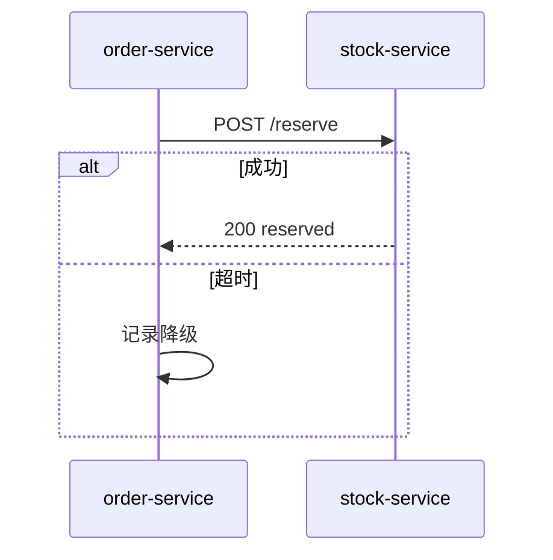
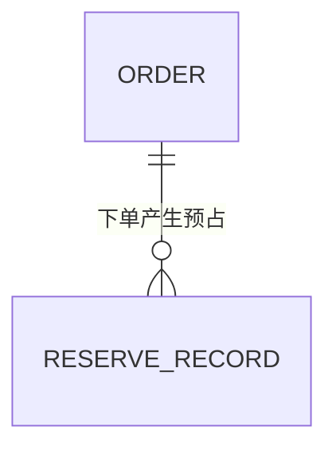

# 库存预占记录接入方案

> 状态：草案待评 ｜ 作者：@a ｜ 评审人：@b ｜ 拍板人：@c ｜ 最后更新：2026-11-03

## 背景与目标

现状靠 T+1 对账发现超卖，本期在下单前加一次库存预占校验。

目标：超卖工单从月均 37 起降到 5 起以内（口径：工单系统 oversell 标签月度聚合）。

## 总体架构

订单服务新增编排层，调用库存服务预占接口，失败按超时与 5xx 两类分别处置。
不新增部署单元，复用现有订单与库存集群。

## 核心流程

正常路径只有一次同步调用，超时或 5xx 走降级放行并记录预占尝试。

## 数据模型

只新增一张预占记录表，记录请求与结果，供对账与排障。

## 备选与取舍

方案 A：不做，维持事后对账，代价是超卖工单不降；方案 B：同步预占，代价是多一次 RPC。选 B。
