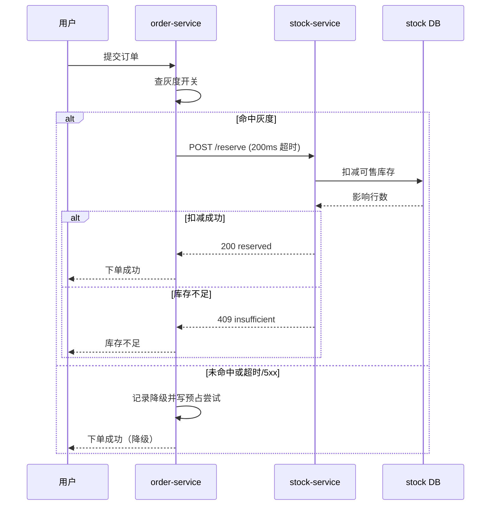

# 订单服务接入实时库存校验技术方案

> 状态：草案待评 ｜ 作者：@morehao ｜ 评审人：@wanglei ｜ 拍板人：@zhangqi ｜ 最后更新：2026-10-26

## 摘要（TL;DR）

下单链路在提交订单前增加一次库存预占校验，把超卖从「事后对账发现」提前到「下单即拦截」。
方案复用库存服务既有的预占接口，新增 200ms 超时、熔断与本地降级开关，预计下单 P99 增加 15ms。
主要风险是库存服务不可用时的降级策略，已用灰度双跑对账兜底。

## 背景与目标

### 读者与关切

| 谁 | 关心什么 | 在哪一节回答 |
|---|---|---|
| 交易团队（调用方） | 下单接口契约是否变化、怎么灰度 | 接口设计、发布与回滚 |
| 库存团队（依赖方） | 新增预占流量对峰值水位的影响 | 开放问题、容量推导 |
| SRE | 失败时的降级与回滚是否可观测 | 回滚触发条件、开放问题 |

### 业务背景与现状

当前下单只校验商品状态，库存扣减发生在支付回调之后，超卖靠 T+1 对账发现。
2026 年 9 月超卖工单 37 起，平均处理时长 4.5 小时（工单系统标签 `oversell` 的月度聚合口径）。
库存服务已有预占接口 `POST /stock/reserve`，目前只有秒杀链路在用（`stock-service/src/api/reserve.go:42`）。

### 目标与非目标

- 业务目标：超卖工单从月均 37 起降到 5 起以内，按 2026 年 9 月口径统计。
- 技术目标：下单接口 P99 从 180ms 增加到不超过 200ms，预占成功率不低于 99.5%。
- 非目标：本期不做预占额度的自动释放（依赖支付超时回调，属支付域改造）。
- 反目标：超卖工单降到 5 起以内、但下单 P99 涨过 250ms，同样算失败——用下单变慢换少投诉，是把问题从客服挪到了转化率；越过 250ms 即回滚。

### 验收标准

- 灰度 7 天内，超卖工单数 ≤5 起/月（按工单系统 `oversell` 标签统计）。
- 下单接口 P99 ≤200ms（APM 采样，5 分钟窗口，取 p99）。
- 预占失败率 ≤0.5%（失败请求数 / 总请求数，5 分钟窗口，APM 采样）。

## 总体架构设计

### 架构设计原则

- 校验逻辑放在订单域内，库存域只提供接口，避免双向依赖。
- 任何新增的同步调用都必须有超时与降级路径，不允许裸调用。
- 降级后的行为必须与现状等价，不引入新的数据不一致。

### 系统上下文与依赖

订单服务依赖库存服务（同步 HTTP）、商品服务（已存在）与配置中心（开关下发）。
库存服务是四级依赖，不可用时订单服务按降级策略放行，由支付回调时的扣减兜底。

## 方案与选型对比

### 备选方案

| 方案 | 做法 | 代价 | 结论 |
|---|---|---|---|
| 现状不动 | 保持事后对账，靠人工补单 | 超卖工单维持 37 起/月 | 与业务目标冲突，否决 |
| 同步预占 | 下单前调 `POST /stock/reserve` | 下单链路多一次 RPC，P99 增加 15ms | 采纳 |
| 异步校验 | 下单后发消息校验，失败再逆向补偿 | 用户侧无感，但超卖窗口仍在 | 未满足「下单即拦截」，否决 |

### 技术选型对比

同步预占的传输层在 gRPC 与 HTTP 间比较：库存服务已提供 HTTP 接口且网关已接入鉴权，
gRPC 需新增 proto 与双端改造，本期收益不足以覆盖成本，故选 HTTP + 连接池复用。

### 选型风险与回退路径

预占接口在峰值 QPS 8000 时可能成为瓶颈，回退路径是关闭开关、退回现状。
开关按租户维度下发，可先对 1% 租户灰度。

## 详细技术设计

### 模块划分与职责

- `OrderSubmitHandler`：编排校验，持有开关与超时策略，不直接访问库存存储。
- `StockReserveClient`：封装 HTTP 调用、重试与熔断，超时 200ms。
- `ReserveResultRecorder`：异步记录预占结果供对账，写入失败不影响主链路。

### 接口设计

调用库存服务 `POST /stock/reserve`，请求体含 `sku_id`、`quantity`、`tenant_id`、`request_id`。
幂等键用 `request_id`（由订单号派生），重复提交返回首次结果。
错误码分三类：库存不足（业务拒绝，直接返回用户）、超时（降级放行）、5xx（熔断并降级）。

### 数据模型

新增 `order_reserve_record` 表记录预占结果，用于对账与排障。

**实体清单**

| 实体 | 职责 | 数据所有权 | 量级 |
|---|---|---|---|
| 预占记录 | 一次预占的请求与结果 | 订单域 | 日均 120 万行，保留 90 天 |

**字段**

| 字段 | 类型 | 可空 | 说明 |
|---|---|---|---|
| id | BIGSERIAL | 否 | 主键 |
| order_id | VARCHAR(32) | 否 | 订单号 |
| sku_id | VARCHAR(32) | 否 | 商品 SKU |
| reserve_status | SMALLINT | 否 | 0 成功 / 1 不足 / 2 降级放行 |
| created_at | TIMESTAMPTZ | 否 | 创建时间 |

**索引与查询匹配**

| 索引 | 服务的查询 |
|---|---|
| `idx_order_id` | 按订单号查预占结果（排障主路径） |
| `idx_created_at` | 按时间窗口对账（T+1 任务） |

### 核心流程

正常路径只有一次同步调用：下单服务在落单前调库存服务预占，成功才继续，库存不足直接拒单。
超时或 5xx 走降级放行，同时记录一条预占尝试，供 T+1 对账兜底。



### 存储设计

记录表按 `created_at` 月分区，保留 90 天，冷数据归档到对象存储。
日增 120 万行、单行约 200B，90 天约 21GB，单分区不超过 8GB。

## 性能与容量设计

预占校验是同步旁路，峰值按库存服务 2026-09 压测的 8000 QPS 估算（口径：峰值 5 分钟窗口）。
单实例按 200 QPS 设计，2 倍冗余部署 10 台；扩容阈值设在单实例 150 QPS（依据：2026-09 压测单实例上限）。
压测方案：预发环境按 8000 QPS 持续 30 分钟（口径：5 分钟窗口），观察 P99 与错误率，未达标不灰度。

## 安全设计

预占接口仅内网可达，调用方用服务身份鉴权（mTLS + 服务白名单），不暴露公网。
预占记录含订单号与 SKU，不含手机号等个人敏感信息；日志对订单号脱敏后落盘。

## 可观测性设计

预占成功率、超时率、降级次数三个指标接入现有 APM 面板，按 1 分钟粒度聚合。
预占失败率连续 10 分钟超过 0.5% 触发告警，直达订单 SRE 值班；降级开关状态同步到变更系统。

## 部署与资源拓扑

复用现有订单与库存服务集群，不新增独立部署单元；预占记录落在现有订单库的独立分区。
订单服务与库存服务各增 2 台实例，跨两个可用区部署，无新增中间件。

## 成本分析

存储月成本约 30 元，可忽略（依据：现有云盘单价折算）。
多承载 8000 QPS 需增 4 台实例（依据：单实例 200 QPS 上限推导），按月折算约 3200 元。

## 上线与回滚

### 发布策略

先灰度 1% 租户 3 天，再放到 10% 观察 4 天，最后全量。
灰度期间每日核对超卖工单数与预占失败率两项指标。

### 回滚触发条件

预占失败率连续 10 分钟超过 0.5%，或下单 P99 连续 10 分钟超过 200ms，即关闭开关回退现状。
回滚动作是配置中心切开关，无需发版，生效时间小于 30 秒。

## 验证与验收

### 验证手段

灰度期双跑对比：同一批订单同时走新链路与现状逻辑，比较超卖判定差异。
预发环境按峰值 QPS 8000 压测 30 分钟，观察 P99 与错误率。

### 最脆弱假设

假设库存服务预占接口在 8000 QPS 下 P99 不超过 100ms（依据：库存域 2026-09 压测报告）。
该假设不成立时方案退化为「仅在低峰时段开启」，Plan B 是与库存域共建本地缓存预占。

## 方案沉默清单

方案正文没写的输入与状态，线上一样会来。沉默不等于许可，逐条给默认行为与确认人。

| 未覆盖的输入 / 状态 | 遇到时的默认行为 | 由谁确认 |
|---|---|---|
| 商品在下架流程中仍被预占 | 允许预占，下单后由商品域返回不可售，预占按超时自动释放 | 商品域 |
| 同一用户连点两次提交同一 SKU | 以 `orderNo` 幂等，第二次返回首次结果，不重复预占 | 订单服务 |
| 人工改库存后与预占量对不上 | 以对账口径为准，预占量按流水重算，差异进工单 | 运营 + 后端 |
| 预占请求超时但服务端已扣减 | 视为成功，靠 T+1 对账发现并回补 | 后端 |

## 已知未覆盖

- 预占额度自动释放依赖支付超时回调，本期不解决，由支付域二期改造承接；被撞上时按对账回补。
- 跨仓调拨场景的库存锁定规则未覆盖，需库存域给出分仓口径后再设计。

## 开放问题与后续工作

### 开放问题

- 预占记录的保留期 90 天是否满足审计要求，需与合规确认，默认倾向保留 90 天。
- 库存服务的真实峰值水位 `[待核实]`：本文按 8000 QPS 估算，需从库存域监控确认。
- 预占额度自动释放的时机依赖支付超时回调，本期不做，列入二期。

### 决策记录（ADR）

| 决策 ID | 决策 | 承接需求 | 备选（含不做） | 验证手段 | 状态 | 置信度 |
|---|---|---|---|---|---|---|
| D-01 | 下单前同步预占，超时降级放行 | R-01 | 现状不动 / 异步校验 | 灰度双跑差异率 | Accepted | 中 |
| D-02 | 传输层用 HTTP 复用现有接口 | R-02 | gRPC 改造 / 现状不动 | 压测 P99 对比 | Accepted | 高 |

## 附录

### 数据模型 DDL

```sql
CREATE TABLE order_reserve_record (
  id BIGSERIAL PRIMARY KEY,
  order_id VARCHAR(32) NOT NULL,
  sku_id VARCHAR(32) NOT NULL,
  reserve_status SMALLINT NOT NULL,
  created_at TIMESTAMPTZ NOT NULL DEFAULT now()
);
CREATE INDEX idx_order_id ON order_reserve_record (order_id);
CREATE INDEX idx_created_at ON order_reserve_record (created_at);
```

### 术语

预占：在下单时冻结库存额度，支付成功后转扣减，超时未支付则释放。
降级放行：预占不可用时跳过校验，由支付回调扣减兜底，可能产生超卖。
